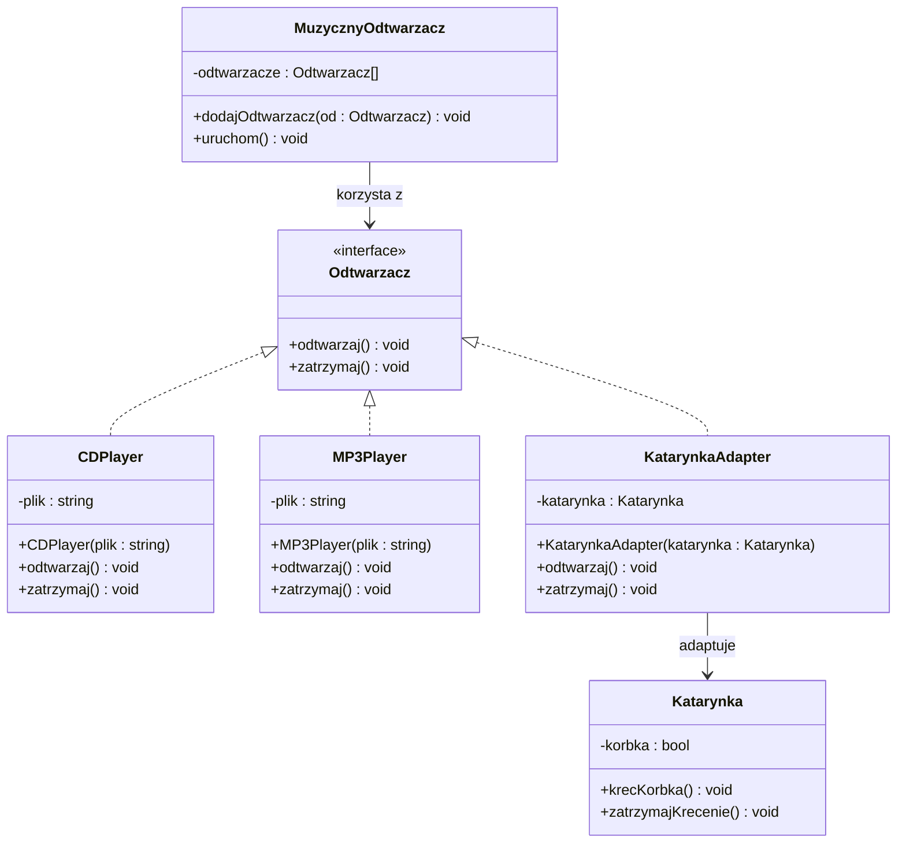

# Zadanie laboratoryjne  


[](https://en.cppreference.com/w/)
[](https://docs.oracle.com/en/java/)

**Przedmiot:** *Programowanie obiektowe*  

##  Dane studenta


| Pole | Wartość |
|---|---|
| Imię i nazwisko | Szymon Zeller |
| Numer albumu | 10149 |
| Kierunek / specjalność | Informatyka |
| Rok/Semestr | I |
| Grupa laboratoryjna | grupa 1 |
| Rok akademicki |  2025/2026|
| Prowadzący | mgr inż. Artur Pelo |

##  Informacje o zadaniu

| Pole | Wartość |
|---|---|
| Numer laboratorium | 2 |
| Temat laboratorium | Podstawy programowania obiektowego - dziedziczenie i polimorfizm |
| Data realizacji | 07.04.2026 |
| Data oddania | 07.04.2026 |
| Język programowania | CPP |
| Środowisko / IDE | VSC |

##  Treść zadania

Krótki opis zadania:

Napisz program, który umożliwa odtworzenie muzyki na katarynce. Klasa Katarynka ma metode krecKorbka oraz zatrzymajKrecenie. 
Dopisz 2 klasy: CDplayer oraz MP3Player implementujące interface Odtwarzacz. Stosując polimorfizm, oraz wzorzec adaptera, zaprogramuj funkcjonalność odtwarzania muzyki z różnych nośników.

##  Wymagania funkcjonalne

| ID | Opis wymagania | Poziom |
|---|---|---|
| WF-01 | Program umożliwia odtwarzanie muzyki z katarynki (metody: krecKorbka, zatrzymajKrecenie). | Wysoki |
| WF-02 | Program umożliwia odtwarzanie muzyki z CD za pomocą klasy CDplayer. | Wysoki |
| WF-03 | Program umożliwia odtwarzanie muzyki z MP3 za pomocą klasy MP3Player. | Wysoki |
| WF-04 | Implementacja wykorzystuje interface Odtwarzacz i polimorfizm w klasach potomnych. | Wysoki |
| WF-05 | Zastosowany jest wzorzec adaptera do integracji różnych nośników (dla katarynki) | Wysoki |

##  Wymagania niefunkcjonalne

| ID | Opis wymagania | Poziom |
|---|---|---|
| WN-01 | Kod jest napisany w języku C++ zgodnie z zasadami programowania obiektowego. | Wysoki |
| WN-02 | Program kompiluje się bez błędów w standardowym kompilatorze C++ (np. g++). | Wysoki |
| WN-03 | Kod jest czytelny i podzielony na klasy odpowiadające odtwarzaczom. | Średni |
| WN-04 | Interfejs tekstowy programu zawiera jasne komunikaty dla użytkownika. | Średni |

##  Realizacja zadania


Opis implementacji:

Zaktualizowanie klasy "Katarynka" za pomocą wzorca projektowego Adapter, oraz stworzenie kolejnych dwóch klas "MP3Player" oraz "CDPlayer" opartych na interfejsie "Odtwarzacz"

##  Diagram klas (jeśli dotyczy)


##  Kod źródłowy


###  C++

```cpp
#include <iostream>

using namespace std;

        //  INTERFACE
class Odtwarzacz{
    public:
        virtual void odtwarzaj() = 0;
        virtual void zatrzymaj() = 0;
};

//  Old and depreciated class to be used in the exercise to adapt
class Katarynka{
    private:
        bool korbka;
    public:
        void krecKorbka(){
            korbka = true;
            cout<<"Kreci korbka"<<endl;
        }
        void zatrzymajKrecenie(){
            korbka = false;
            cout<<"Przestaje krecic korbka"<<endl;
        }
};

        //  ADAPTER
class KatarynkaAdapter: public Odtwarzacz{
    private:
        Katarynka *katarynka;
    public:
        KatarynkaAdapter(Katarynka *katarynka){
            this->katarynka = katarynka;
        }
        void odtwarzaj(void) override{
            this->katarynka->krecKorbka();
        }
        void zatrzymaj(void) override{
            this->katarynka->zatrzymajKrecenie();
        }
};

class CDPlayer: public Odtwarzacz{
    private:
        string plik = "muzyka_z_CD";
    public:
        CDPlayer(string plik) : plik(plik){}
        void odtwarzaj() override{
            cout<<"Odtwarzam plik: "<<plik<<endl;
        }
        void zatrzymaj() override{
            cout<<"Zatrzymuje plik: "<<plik<<endl;
        }
};

class MP3Player: public Odtwarzacz{
    private:
        string plik = "muzyka_z_MP3";
    public:
        MP3Player(string plik) : plik(plik){}
        void odtwarzaj() override{
            cout<<"Odtwarzam plik: "<<plik<<endl;
        }
        void zatrzymaj() override{
            cout<<"Zatrzymuje plik: "<<plik<<endl;
        }
};

int main(int argc, char const *argv[])
{
    int decyzja;
    Odtwarzacz *user = NULL;
    Katarynka *katarynka = new Katarynka();
    CDPlayer *cdPlayer = new CDPlayer("muzyka_z_CD");
    MP3Player *mp3Player = new MP3Player("muzyka_z_MP3");
    KatarynkaAdapter *katarynkaAdapter = new KatarynkaAdapter(katarynka);

    do{
        cout<<" 1. Odtwarzacz CD \n 2. Katarynka \n 3. Odtwarzacz MP3 \n 5. Graj \n 6. Zatrzymaj \n 0. Wyjdz"<<endl;
        cin>>decyzja;
        switch(decyzja){
            case 1:
                user = cdPlayer;
                cout<<"Wybrano CD"<<endl;
                break;
            case 2:
                user = katarynkaAdapter;
                cout<<"Wybrano Katarynke"<<endl;
                break;
            case 3:
                user = mp3Player;
                cout<<"Wybrano MP3"<<endl;
                break;
            case 5:
                if(user != NULL){
                    user->odtwarzaj();
                }
                break;
            case 6:
                if(user != NULL){
                    user->zatrzymaj();
                }
                break;
            case 0:
                cout<<"Wyjscie z programu"<<endl;
                break;
        }
    }while(decyzja != 0);

    delete(katarynka, cdPlayer, katarynkaAdapter, mp3Player);
    return 0;
}

```

##  Wynik działania programu

Opis testów i przykładowe wyniki:

Skompliowanie i wybranie Katarynki, zaczęcie kręcenia i zatrzymanie oraz wyjście z programu
```bash
PS D:\CODE\VSCODE\PRJ\programowanie_obiektowe\2026_04_07>  & 'c:\Users\Orrimano\.vscode\extensions\ms-vscode.cpptools-1.31.4-win32-x64\debugAdapters\bin\WindowsDebugLauncher.exe' '--stdin=Microsoft-MIEngine-In-poco2ejr.ik1' '--stdout=Microsoft-MIEngine-Out-s2ktyhhb.nhd' '--stderr=Microsoft-MIEngine-Error-vn2xqzsd.r2t' '--pid=Microsoft-MIEngine-Pid-1bzgdfxd.kpr' '--dbgExe=C:\msys64\ucrt64\bin\gdb.exe' '--interpreter=mi' 
 1. Odtwarzacz CD 
 2. Katarynka 
 3. Odtwarzacz MP3 
 5. Graj 
 6. Zatrzymaj 
 0. Wyjdz
2
Wybrano Katarynke
 1. Odtwarzacz CD 
 2. Katarynka 
 3. Odtwarzacz MP3 
 5. Graj 
 6. Zatrzymaj 
 0. Wyjdz
5
Kreci korbka
 1. Odtwarzacz CD 
 2. Katarynka 
 3. Odtwarzacz MP3 
 5. Graj 
 6. Zatrzymaj 
 0. Wyjdz
6
Przestaje krecic korbka
 1. Odtwarzacz CD 
 2. Katarynka 
 3. Odtwarzacz MP3 
 5. Graj 
 6. Zatrzymaj 
 0. Wyjdz
0
Wyjscie z programu

```
Skompliowanie i wybranie MP3Player, zaczęcie grania i zatrzymanie oraz wyjście z programu

```bash
PS D:\CODE\VSCODE\PRJ\programowanie_obiektowe\2026_04_07>  & 'c:\Users\Orrimano\.vscode\extensions\ms-vscode.cpptools-1.31.4-win32-x64\debugAdapters\bin\WindowsDebugLauncher.exe' '--stdin=Microsoft-MIEngine-In-0qmzfnee.tdd' '--stdout=Microsoft-MIEngine-Out-5m0wgpe3.0iy' '--stderr=Microsoft-MIEngine-Error-z0ic35j5.pgd' '--pid=Microsoft-MIEngine-Pid-gakx0qss.w5s' '--dbgExe=C:\msys64\ucrt64\bin\gdb.exe' '--interpreter=mi' 
 1. Odtwarzacz CD 
 2. Katarynka 
 3. Odtwarzacz MP3 
 5. Graj 
 6. Zatrzymaj 
 0. Wyjdz
3
Wybrano MP3
 1. Odtwarzacz CD 
 2. Katarynka 
 3. Odtwarzacz MP3 
 5. Graj 
 6. Zatrzymaj 
 0. Wyjdz
5
Odtwarzam plik: muzyka_z_MP3
 1. Odtwarzacz CD 
 2. Katarynka 
 3. Odtwarzacz MP3 
 5. Graj 
 6. Zatrzymaj 
 0. Wyjdz
6
Zatrzymuje plik: muzyka_z_MP3
 1. Odtwarzacz CD 
 2. Katarynka 
 3. Odtwarzacz MP3 
 5. Graj 
 6. Zatrzymaj 
 0. Wyjdz
0
Wyjscie z programu

```
##  Lista kontrolna samooceny

| Kryterium | 
|---|
| Program kompiluje się bez błędów | 
| Wszystkie wymagania zostały spełnione | 
| Kod jest czytelny i podzielony na klasy | 
| Zastosowano zasady OOP | 
| Zastosowano zasady czystego kodu | 
| Zastosowano wzorce projektowe  | 


## 💾Przesłanie pliku do oceny:
Nazwa pliku do przesłania: PO_Lab2_KowalskiJan.zip (https://upload.pelo.com.pl) 


##  Ocena prowadzącego

| Element oceny | Punkty maks. | Punkty uzyskane |
|---|---:|---:|
| Poprawność działania | 5 |  |
| Zastosowanie OOP | 5 |  |
| Jakość kodu | 3 |  |
| Terminowość oddania | 2 |  |
| **Suma** | **15** |  |

Uwagi prowadzącego:

................................................................................

................................................................................

Ocena końcowa(skala ocen: 2, 2.5, 3, 3.5, 4, 4.5, 5): .......... 

Podpis prowadzącego: ........................................................

